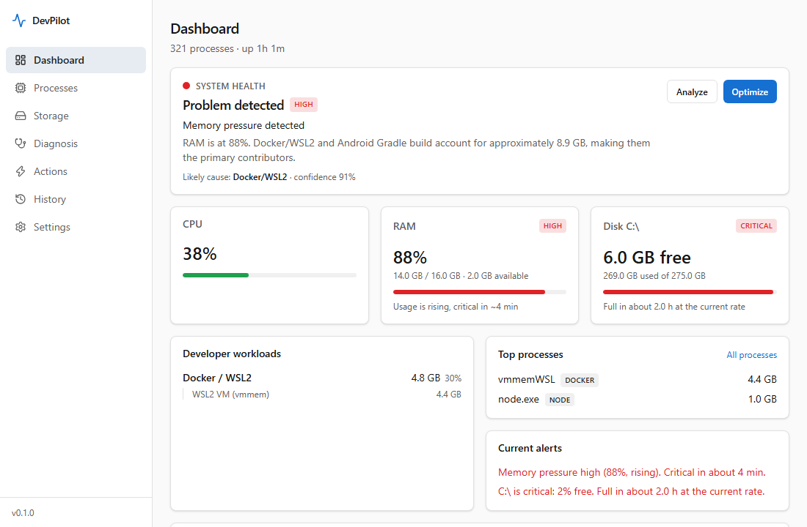

# DevPilot

A lightweight Windows health assistant for developers. It answers one question:

> **Why is my development PC slow, freezing, running out of RAM or running out of disk, and what can I safely do about it?**

It watches RAM, CPU and disks, recognises developer workloads (Docker/WSL2, Android/Gradle, Next.js, Laragon, IDEs...), names the cause with numbers and confidence, and offers fixes you can preview first. It works fully offline; AI assistance is optional and off by default.



## What it does

- **Dashboard**: system health in one glance, RAM pressure state and trend, per-drive state with "full in about 2 h" predictions, developer workloads with their members, top processes, alerts, recent diagnoses.
- **Processes**: live table with evidence-based categories (IDE vs Node vs Docker...), redacted command lines, Docker containers.
- **Storage**: read-only scan for caches, `node_modules`, build output, old APKs and large files, classified `SAFE_TO_CLEAN / SAFE_TO_REVIEW / REQUIRES_REVIEW / DO_NOT_TOUCH`. Every deletion shows a preview and needs confirmation (two for destructive).
- **Diagnosis**: rule engine explains *why* ("RAM is at 96%. Docker/WSL2 and Android Gradle build account for approximately 8.9 GB, making them the primary contributors.") with contributors, confidence, evidence and recommendations (problem, explanation, benefit, risk, action).
- **Actions**: whitelisted, risk-gated, undoable where possible (stop container, shut down WSL, stop Gradle daemons, close one process, delete one scanned item, clean old temp files).
- **History**: RAM, CPU and free-space charts from 15 minutes to 30 days, past diagnoses and actions. Recorded in the background, also while minimised to the tray.
- **Tray**: Open DevPilot, System Status, Scan Storage, Run Diagnosis, Settings, Quit. Closing the window keeps monitoring running at about 41 MB.
- **Optional AI**: bring your own OpenAI-compatible, Anthropic-compatible or local (Ollama) endpoint. Only a sanitized summary is sent, you can inspect it first, and the AI can suggest but never act.

## Design principles

Windows first. Rust core owns all monitoring; no Node daemon, no Electron. Offline by default. Nothing is deleted or closed without an explicit, previewed confirmation. Unknown things are classified `OTHER` or `REQUIRES_REVIEW`, never guessed. Each subsystem fails on its own (no Docker, no SQLite, no AI) without taking the app down.

## Stack

Tauri 2, Rust (sysinfo, windows-rs, SQLx/SQLite, ureq, keyring), React 19, TypeScript 6, Vite 8, Tailwind CSS 4, shadcn-style components (Radix, lucide-react), Recharts, react-router (HashRouter).

## Install

There is no published release yet. `pnpm tauri build` produces a per-user NSIS installer (3.2 MB, no administrator rights) under `src-tauri/target/release/bundle/nsis`. It is **not code-signed**, so Windows SmartScreen will warn. Windows 10/11 with the WebView2 runtime (preinstalled on Windows 11).

## Build from source

Prerequisites (versions verified on Windows 11 10.0.26200):

| Tool | Version | Install |
|------|---------|---------|
| Node.js | 22.13.1 | https://nodejs.org |
| pnpm | 12.16.1 | `npm i -g pnpm` |
| Rust (MSVC toolchain) | 1.99.1 | `winget install Rustlang.Rustup`, then `rustup default stable-x86_64-pc-windows-msvc` |
| VS 2022 Build Tools | 17.14, "Desktop development with C++" | `winget install Microsoft.VisualStudio.2022.BuildTools --override "--quiet --wait --norestart --add Microsoft.VisualStudio.Workload.VCTools --includeRecommended"` |
| WebView2 Runtime | 156 | preinstalled on Windows 11 |

Notes: Build Tools need 6-8 GB free on C: (error `0x80070070` means disk full). The winget Rustup install can exit 1 when MSVC is missing; run `rustup default stable-x86_64-pc-windows-msvc` manually. On Windows PowerShell 5.1, `Set-Content -Encoding utf8` writes a BOM that breaks JSON config; write files without BOM.

```powershell
pnpm install
pnpm tauri dev      # run with hot reload
pnpm tauri build    # NSIS installer: src-tauri/target/release/bundle/nsis
```

## Tests

```powershell
cd src-tauri; cargo test; cargo clippy --all-targets -- -D warnings   # Rust
pnpm test                                                              # Vitest: UI + logic
pnpm test:e2e                                                          # Playwright in Chromium
```

Current counts: see [docs/DEVELOPMENT.md](docs/DEVELOPMENT.md#tests). Vitest uses `happy-dom` because `jsdom` crashes on Node 22.13.1.

## Documentation

[Architecture](docs/ARCHITECTURE.md) · [Monitoring](docs/MONITORING.md) · [Diagnosis](docs/DIAGNOSIS.md) · [Storage](docs/STORAGE.md) · [Actions](docs/ACTIONS.md) · [AI](docs/AI.md) · [Security](docs/SECURITY.md) · [Development](docs/DEVELOPMENT.md)

## Honest limits

- Memory with the window **open** is about 460 MB, nearly all WebView2. With the window closed it is about 41 MB (the WebView is destroyed and recreated on demand). The 150 MB target is met in the resident, tray-only state, not while the window is showing.
- Storage lists show 100 rows at a time ("Show more") rather than a virtualized list; process lists are capped at 500 rows by the backend.
- Without administrator rights some process paths and command lines cannot be read; those processes are classified by name only and flagged as such.
- The "pagefile usage" signal is an estimate derived from commit charge, not the pagefile's resident size.
- Memory-growth detection reports a *possible* leak with confidence; caches and builds also grow.
- The installer is unsigned.

## License

Not yet specified.
